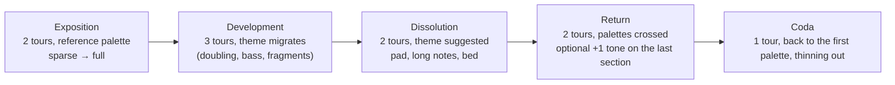

# Long-form pieces: one theme, many interpretations (15–60 min)

Use this when the user wants a very long track that keeps one theme (or a cycle of themes) and varies it tour after tour. Written from a 33-minute, 11-tour suite built and verified on `@strudel/repl@1.3.0` (2026-10-13). These are devices and constraints, not a form to copy.

## 1. Decide the listening mode first
| | Background listening | Attentive listening |
|---|---|---|
| Surprise | delayed: the listener notices *afterwards* that the palette changed | immediate contrasts allowed |
| Transitions | cross-fades only; no hard cut, no drop, no dramatic silence | cuts, risers, gaps are devices |
| Tempo / meter | constant | one change max (half-time, 6/8→4/4) |
| Key | ≤ 1 modulation, with a return | 1–2 |
| Density floor | never empty; the quietest tour still has a bed | an almost-empty tour is the memorable moment |

The arc is the same in both modes; the mode decides how sharp the edges are.

## 2. What varies, and what each variation costs the ear
| Dimension | Perceived effect | Writing cost | Use |
|---|---|---|---|
| Orchestration (palette) | strong | low | may change every tour |
| Kit / groove | strong | low | may change every tour |
| Density (layer count) | very strong | none | the main tool: waves of thin → full → thin |
| Role of the theme (lead → doubling → counter-melody → bass → fragments → suggested → absent → return) | very strong | medium | one change per act |
| Harmony (reharmonisation, pedal, modal) | strong | high | 1–2 times per piece |
| Tempo / meter | very strong | medium | 0–1 times |
| Key | medium | low | 1–2 times, always return |
| Micro (sample variant, grace notes, pan drift, hat dropouts, fills) | weak but cumulative | none | random every cycle; the only randomness |

Rules that held up:
- **At most two major dimensions change per tour.** Three at once reads as "a different track", not a variation.
- **The theme must travel.** Repeating it identically as the lead wears out after ~6 minutes; moving it (bass, fragments, long notes only, octave below as an answer) keeps it present without being central.
- **Randomness produces noise, not surprise.** Surprise is an expectation built over 2–3 tours and then bent. Keep the piece deterministic; let only micro-variation roll.
- **Styles as a gradient, not blocks.** Change one voice per tour; three tours later you are in another idiom without a "moment" where it switched. A palette block of 3 minutes is three tracks in a row.

## 3. Arc template (adapt, do not transcribe)

Density in waves: peak at tour 4, trough at 5, peak at 7, trough at 9, peak at 10, fade at 11. A trough tour keeps one melodic voice, one bed (pad / drone / sea) and at most a soft pulse.

## 4. Code architecture (see `templates/long-form.js`)
1. **Material**: every melodic/harmonic line once, as `note("<…>")` constants. Chord voicings as **three separate voice lanes** (`lo/mi/hi`), never `[a,b,c]` chords when a `struct()` follows (it fragments chords; see gotchas).
2. **Timbre factories** `xxxOf(pat)` that set `s`, envelope, filters, pan, **and `gain`** (bridges rely on it). Three fixed spaces: `near` (orbit 1), `far` (orbit 2), `wash` (orbit 3). Never one orbit per palette.
3. **Kits** as constants (`kitFaithful`, `kitCeltic`…), each a `stack` of labelled lanes.
4. **Tours as role objects**: `{pickA, leadA, leadA2, leadB, chordsVamp, chordsA, …, bassB, extrasVamp…extrasB, kit}`; missing roles mean silence (`up(x) = x ?? silence`). A new tour is `{...prev, lead: …, kit: …}` — the spread *is* the "two changes" discipline made visible.
5. **`tourOf(p)`** unrolls the form once for every tour (`[[2, vamp], [9, A], [2, vamp], [11, A2], [3, vamp], [9, B]]`). Never write hundreds of cycles by hand.
6. **Bridges by role identity**: `br(a, c)` compares each role with `===`; an unchanged pattern object plays through untouched, a changed one cross-fades (`mul(gain(saw.range(1, .08).slow(4)))` out, `mul(gain(saw.range(.1, 1).slow(4)))` in). The bridge material is the source's own vamp, so it never sounds like a device. `brTo` adds the incoming tour's pickup, fading in, so the next lead is announced.
7. **`freeze`** = `ribbon(0, n)` on every section: 2-entry cells (`<a b>`) would otherwise flip parity on later tours and the loop comparison would fail.
8. **Primer**: a `stack` of `s(name).note("c4").struct("x").gain(0).clip(.1)` for every soundfont/sample that first appears after tour 1, masked into tour 1's vamp. Verified in `superdough.mjs`: `onTrigger` (which loads the font) runs before `gain` is read, so a gain-0 event does preload.
9. One `$: arrange(...freeze(tourOf(t1)), ...freeze([brTo(t1, t2)]), …).postgain(x)`.

Transpiler traps that bite exactly this architecture (details in `strudel-gotchas.md`): role keys as strings (`["kit"].map(k => t[k])`) and `${…}` inside pattern templates both yield **zero events without an error**. Use accessor functions and literal strings only as direct call arguments.

## 5. Runtime budget
- 440 cycles of shared material evaluated in ~60 ms; the size of `arrange` is not the issue, duplicated material is.
- 15–20 soundfonts loaded over the piece were fine; keep palettes to 4–5 sounds each and share across tours.
- Long sustained sounds (drone, sea, pad): **one event per section** (`note("g2").slow(n)`, `clip(1.01)`), not one per cycle — re-attacking a 0.8 s attack every 2 s pumps. Fade a single long event with `clip(.55).release(3)`, not with a `saw` (sampled once at onset).

## 6. Proportionate verification for 400+ cycles
Do not render the piece. Exercise, in this order, and stop when each risk is closed:
1. `check-track.py` (names, `@.5`, string-key traps, broken samples).
2. `verify-track.py --tours N --tour-len L --ranges --labels`: per tour, the sound set and event counts per label in A, B and bridge windows; global min/max MIDI per `gm_*` and the `badNotes` list; loop check `cycle 0 ≡ cycle N·L`. **Compare label counts with what you intended** (strums × voices, 12 hats per cycle…): a silent shortfall is the typical bug (one chord voice missing, a bridge with zero events).
3. One bridge inspected numerically (`--begin <bridge> --cycles 4 --labels`): unchanged roles at full gain, changed roles ramping both ways.
4. `--render` on the densest tour and on the quietest one only (peak/RMS).
5. Deliver with a table *tour × interpretation × role of the theme* and ask the one useful question: **at which minute did you drift or tune in?**
